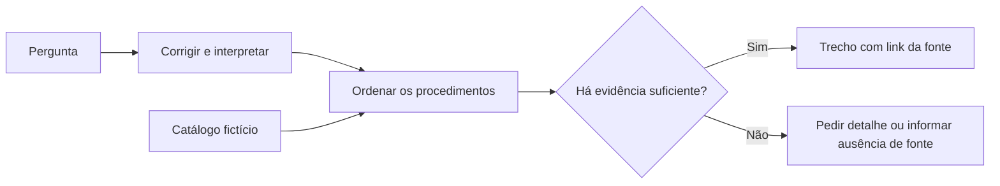

# Atlas de Processos

Demonstração de um portal de conhecimento operacional. O catálogo organiza procedimentos por categoria e o assistente encontra trechos relevantes para responder perguntas com indicação da fonte. Os oito procedimentos, telas de referência e prazos descritos são fictícios.

## Abra a demonstração

Abra **`index.html`** no navegador. Ele contém a interface, os dados e o motor de busca, sem dependência de servidor, conta ou API. Para experimentar:

1. Busque **chamdo** no catálogo e aplique a categoria Atendimento.
2. No Assistente, pergunte **Como redefinir a snha?** e depois **E qual é o prazo?**.
3. Abra o link da fonte para ver a seção correspondente.
4. Pergunte **Qual é a previsão do tempo?** para observar a resposta quando a base não tem evidência.
5. Salve um procedimento nos Favoritos e alterne entre tema claro e escuro.

## O problema técnico

Em uma base de conhecimento, localizar um procedimento depende de encontrar o assunto mesmo quando a pergunta chega com outra expressão ou com erros de digitação. Para responder com rastreabilidade, a busca precisa selecionar a seção que de fato contém a orientação.

Esta edição adapta o motor de busca da central original. O motor usa distância de edição com vocabulário delimitado, sinônimos, intenção, pontuação por campos e seleção extrativa. Uma resposta apresenta frases da seção citada. Quando o contexto ou a evidência não basta, o assistente pede mais detalhes ou informa a limitação.

A aplicação original usa Google Apps Script e Google Sheets para armazenar e governar conteúdo. Esta demonstração inclui o núcleo de busca e consulta em HTML, CSS e JavaScript. A administração, a autenticação e a base operacional pertencem ao sistema original. Favoritos e tema ficam no navegador; a conversa fica em memória e pode ser limpa na interface.

## Arquivos

| Caminho | O que contém |
| --- | --- |
| `index.html` | Demonstração autônoma, pronta para abrir ou hospedar |
| `src/engine.mjs` | Busca, ranking, contexto e seleção de trechos |
| `src/data.mjs` | Catálogo sintético |
| `src/app.mjs` | Navegação, filtros, favoritos e assistente |
| `src/styles.css` e `src/shell.html` | Aparência e estrutura da interface |
| `scripts/build.mjs` | Gera o HTML autônomo a partir do código-fonte |
| `tests/engine.test.mjs` | Testes de busca, contexto e fidelidade às fontes |

Para desenvolver com Node.js 20+, rode `npm test` e, após editar os arquivos em `src/`, rode `npm run build`. O build e os testes usam apenas os módulos nativos do Node.js.

## Publicar pelo navegador

1. No GitHub, crie um repositório `atlas-de-processos` sem gerar um README.
2. Na tela de envio, arraste o **conteúdo de dentro da pasta** `atlas-de-processos`. Confira que `index.html` e `README.md` estão na raiz e confirme em **Commit changes**.
3. Para disponibilizar a demonstração navegável, abra **Settings → Pages**, selecione **Deploy from a branch**, escolha **main** e **/(root)** e salve. Consulte o [guia oficial de publicação](https://docs.github.com/pt/pages/getting-started-with-github-pages/configuring-a-publishing-source-for-your-github-pages-site).
4. Depois que o GitHub exibir o endereço do site, confira a demonstração e coloque o link em **Destaques** no LinkedIn junto ao repositório.

Use apenas este pacote no repositório de portfólio. Confirme a autorização para compartilhar código derivado do projeto de origem antes da publicação.
